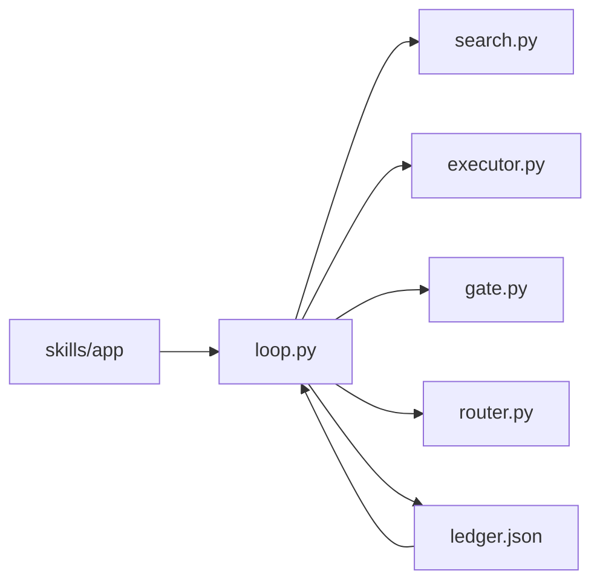

# HPC Optimizer 架构

插件路径：`KPBot/Plugins/hpc-optimizer`。版本 `0.1.0`，维护者 Kunpeng Acceleration Team，许可 MulanPSL-2.0。它在 KPBot marketplace 里与 `code-optimizer`、`app-tuner` 并列。

本插件对一个 HPC 应用做参数试验：读应用模板、选一个轴上的一个值、提交作业、用门控记账。一次调用只跑一步。当前只有 LAMMPS。本版全部试验串行，没有并行试验。

## 场景

- 用户：鲲鹏上的 HPC 性能工程师。
- 前置条件：`skills/<应用>/` 里已经有模板、门控和作业脚本。`route` 可以是空对象。
- 输入：应用目录。
- 输出：`--run-dir/ledger.json`。
- 不适用：向量化改写、算子融合、内存带宽诊断、MPI 通信时间、I/O、NUMA、操作系统、BIOS。这些留在 `code-optimizer` 或 `app-tuner`，本文不设诊断链。`switch` 只切换模板里的 MPI 秩和线程数，不判断通信时间。`balance` 只是参数轴上的离散取值。
- 应用自己的成功指标写在模板里。插件的验收是三条：不传 `--app` 也不传 `--template` 就失败；账本 `version` 为 1，且每条试验都有 `arch` 和 `kunpeng`；`route` 为空时试验没有 `skill`。

## 目录

```text
Plugins/hpc-optimizer/
  .claude-plugin/plugin.json
  check_loop.py                     共享环自检
  docs/architecture.md
  skills/hpc-optimizer/SKILL.md     插件场景卡片
  skills/lammps/                    当前唯一应用
    SKILL.md
    lammps.json                     轴、门控、route、各架构默认版本
    versions/2023.8.2/aarch64.json  该版本的鲲鹏配方
    versions/2023.8.2/x86_64.json   该版本的对照配方
    versions/2025.7.22/x86_64.json  该版本只有对照配方
    lammps.in                       各版本共用的算例
    job.fmt                         作业脚本模板
  hpc_optimizer/                    共享环，不含应用名
    __main__.py                     python3 -m hpc_optimizer
    loop.py                         一步试验
    template.py
    search.py
    executor.py
    gate.py
    router.py
    ledger.py
```

`KPBot/install.sh` 按目录名发现并拷贝 `skills/` 下的每个目录，因此装上的目录是 `hpc-optimizer` 和 `lammps`。`--app` 用的也是目录名。`skills/lammps/SKILL.md` 里的展示名是 `hpc-lammps`。本插件不使用 `subskills`、`scripts`、`references`。下一个应用新建 `skills/<应用名>/`，不改 `hpc_optimizer/*.py`。新应用的 `job.fmt` 只能使用下面「执行」一节列出的占位符；算例末尾要追加的行写在该应用配方的 `append` 里。

## 集成

对外只有命令行和账本文件。没有 MCP，没有 HTTP API，没有共享数据库。本版不调用 KPBot 里已有的 skill，复用方式是不调用：`route` 为空，没有检测器把试验交给它们。

`hpc-optimizer` 与 `hpc-lammps` 不是互相路由。前者是共享环，决定下一次试验；后者是应用模板，目录名 `lammps`，定义轴、算例、版本配方和门控。用户定制搜索空间时改 `skills/lammps/`，不改 `hpc_optimizer/*.py`。按 ScienceFlow 的方法调 LAMMPS，就是改应用模板后重复执行一步命令，用账本续跑。

在插件目录 `KPBot/Plugins/hpc-optimizer` 下启动。入口是 `__main__.py`：

```bash
python3 -m hpc_optimizer --app lammps --run-dir runs/lammps
```

直接执行 `hpc_optimizer/loop.py` 会因找不到包而失败。`--run-dir` 必填。`--app` 读取 `skills/<应用>/<应用>.json`。`--template` 读取一份 JSON 路径，供自检使用。两个都不传时 `step` 抛出 `ValueError`。应用目录不存在时错误是 `unknown app <名称>`。

环境变量：

| 变量 | 作用 |
| --- | --- |
| `HPC_OPT_ARCH` | `aarch64` / `arm64`，或 `x86_64` / `amd64`。缺省用本机 `platform.machine()`。其他值失败。不区分鲲鹏具体型号。 |
| `HPC_OPT_RUN` | 等于 `1` 才执行 `job.sh`。否则只写出脚本和空的 `job.log`。空日志没有性能指标，门控记为 `compile_fail`。下一步 `stop`，`reason` 为 `invalid`。 |
| `HPC_OPT_JARVIS_ROOT` | aarch64 的 HPCRunner 根目录，用来取得 HPCKit 版本变量。缺省是本仓库的 `hpcrunner`。 |
| `HPC_OPT_VERSION` | 选用 `versions/<版本>/<架构>.json`。缺省时，若 `opt/*/src` 里恰好有一个已知源码包或源码目录，用那个版本；否则用目标里的 `version`。版本不是搜索轴。 |

## 一步试验

`loop.py` 是唯一编排者。搜索、执行、门控、路由互相不调用。



`step` 的顺序：

1. 加载模板，按架构取出 `targets` 里的那一份。
2. 读取账本。文件不存在时试验列表为空。
3. `search.decide(template, trials)` 只看模板和已有试验，不打开日志。
4. 动作为 `stop` 时，用停止原因查 `route`。若查到 skill，且上一条试验还没有 `skill`，就把 skill 写上一条。`stop` 本身不追加新行。然后返回。
5. 否则在 `--run-dir/trials/<序号>/` 提交作业。序号是当前试验条数。
6. 门控读 `job.log`，得到指标、`kind` 和是否通过。
7. 写成一条试验。`kunpeng` 由 `loop.py` 单独判断。再用 `kind` 查 `route`，查到才写入 `skill`。
8. 整本账本写回。

未搜索的轴在算例里取该轴的第一个值。被搜索的轴取本次决定的值。一条决定只动一个轴。

## 搜索

五个动作：

- **baseline**：账本为空。取第一条轴的第一个值，执行方式用模板的 `execution`。
- **keep**：同一条轴还有下一个值，并且这是该轴在当前执行方式下的第一个点，或者本条指标不低于上一档通过试验的 `metric * (1 + min_gain)`。
- **redirect**：上面的条件不成立，且后面还有轴。换到下一条轴的第一个值。
- **switch**：本条通过，轴已经走完，当前仍是主执行方式，且模板有 `alt_execution`。改用另一套并行方式，回到第一条轴的第一个值。数值门失败不会进入 `switch`。
- **stop**：不再产生新试验。`reason` 为 `budget`（试验条数达到 `budget`）、`invalid`（编译失败，或数值门失败且没有下一个值、也没有下一条轴）、`exhausted`（通过的试验已经没有轴，也没有另一套执行方式）。

上一条带有 `skill` 且 `rerun` 为假时，下一步仍用同一轴、同一取值再跑一次，`rerun` 为真。这是留给以后路由的重试，LAMMPS 的空 `route` 不会走到。

数值门失败和收益不足共用 `keep` / `redirect`。没有下一个值和下一轴时，数值门失败停在 `invalid`。编译失败不换值，下一步直接 `invalid`。失败试验留在账本里，不把上一组取值再跑一遍。

## 门控

`gate.py` 只读日志和模板里的 `gate`。正则不写在 Python 里。判定顺序：

1. 指标取 `metric_pattern` 的最后一处匹配。没有匹配，或 `compile_pattern` 命中（忽略大小写），则 `kind` 为 `compile_fail`，不通过。
2. 否则按 `drift_columns` 收集「恰好这么多列、且全是数字」的行，用最后一列算 `|末值 - 初值| / |初值|`。少于两行，或超过 `drift_max`，则 `kind` 为 `numeric`，不通过。
3. 其余为 `ok`，通过。指标是最后一处匹配的浮点数。

## 路由

`router.route` 查模板的 `route` 对象。试验结束时键是 `kind`（`ok`、`compile_fail`、`numeric`）。`stop` 时键是 `reason`。缺键、空表、空字符串都返回空，试验不带 `skill`。

LAMMPS 的 `route` 是 `{}`。KPBot 里还没有 HPC 缺陷列表，因此编译失败和能量漂移都留在本插件。x86 上的热点和微架构采集不写进这张表，应用分析走 `app-tuner` 的 `vtune-analysis`。aarch64 仍用 `kptools-devkit` 和 `arm-spe-analysis`。

## 账本

路径是 `--run-dir/ledger.json`。写出的信封：

```json
{ "version": 1, "trials": [] }
```

`load` 在版本不是 1 时失败。它也接受一份旧的纯数组。`save` 总是写成版本 1。

一条试验的字段：

| 字段 | 含义 |
| --- | --- |
| `axis`、`value`、`action` | 本次搜索的轴、取值、动作 |
| `execution` | `mode`、`nodes`、`ranks`、`threads` |
| `log` | `job.log` 路径 |
| `metric`、`passed`、`kind` | 门控结果。`kind` 为 `ok`、`compile_fail` 或 `numeric` |
| `rerun` | 是否为同一取值的重试 |
| `arch` | `aarch64` 或 `x86_64` |
| `kunpeng` | 见下 |
| `version` | 本次使用的应用版本。目标没有 `version` 时不写 |
| `skill` | 仅当 `route` 查到名字时出现 |

`kunpeng` 为真要同时满足三点：`arch` 是 `aarch64`、门控通过、日志里有 `HPC_OPT_INIT_OK`。这个标记由 aarch64 作业在 `source ./init.sh` 成功之后打印。`init.sh` 失败、试验未通过，或架构是 `x86_64`，`kunpeng` 都为假。

## 执行

`make` 按目标的 `backend` 选择执行器。当前 LAMMPS 的两份目标都是 `native`。

`native` 读取应用目录里的配方、算例和 `job.fmt`，写出 `in.trial` 和 `job.sh`。算例用配方里的 `defaults`，再盖上本次参数。配方可以带 `append`：某一参数大于等于 `min` 时插入 `line`。算例里有 `run` 行时插在最后一条 `run` 之前，否则追加到末尾。LAMMPS 各版本配方都写着 `balance >= 1` 时插入 `balance 1.0 shift xyz 5 1.1`。`rcb` 不能和默认的 `comm_style brick` 一起用。共享环不写这行字。

`job.fmt` 的正文由应用自己写。共享环只填入这些占位符，这也是新应用不改 Python 的契约：`setup`、`env`、`deps`、`ranks`、`threads`、`fft_line`、`cmake_extra`、`cxx`、`launcher`、`binary`、`source`、`download_url`、`packages`、`cxx_flags`、`version`、`build_id`。`threads` 写成作业里的 `OMP_NUM_THREADS`。秩和线程的配比由 app-tuner 的 `openmp-mpi-tuning` 给出。共享环不调用它，`route` 也不写它。LAMMPS 的脚本在源码目录已存在时直接编译；否则使用同名 `.tar.gz` 或 `.zip`，两者都没有才按 `download_url` 下载 `.tar.gz`。安装前缀里的 `.hpc-opt-version` 是版本、源码目录、包、编译选项、编译器、FFT 和 cmake 附加项的戳。其中任一项变了，或源码树里有文件新于已安装二进制，就重新编译。`launcher`、`dependency`、进程数和线程数不进这个戳。

aarch64 配方带 `use_jarvis_root`。作业脚本以 `set -euo pipefail` 开头，先进入 HPCRunner 根目录，`source ./init.sh`，成功后才打印 `HPC_OPT_INIT_OK`。`source` 失败时脚本停住，不会打印这个标记。安装前缀来自配方。x86_64 不设置 `JARVIS_ROOT`，前缀在 `--run-dir/opt/<install_name>`。

`backend` 为 `jarvis` 时仍会生成 `./jarvis -use`、`-b`、`-r`。LAMMPS 不用这条路径。

## 应用模板

`skills/<app>/<app>.json` 包含：

- `targets.aarch64` 与 `targets.x86_64`：`backend`、`toolchain`、`version`、`case`。配方路径是 `versions/<version>/<arch>.json`。aarch64 可另记 `jarvis_config`，供对照 HPCRunner 的原配置路径。
- `axes`：名字和离散取值
- `execution`，可选 `alt_execution`
- `min_gain`、`budget`
- `gate`：`metric_pattern`、`compile_pattern`、`drift_columns`、`drift_max`
- `job`：作业脚本模板文件名
- `route`：失败类型到 skill 名。空对象表示留在本插件

配方描述版本、源码包、编译器、启动器、`defaults`，以及可选的 `append`。算例里的 `{参数名}` 由当前取值替换。

## LAMMPS

参数轴：`timestep` 为 2.0、1.0、2.5；`neighbor_skin` 为 2.0、2.5、3.0；`cutoff` 为 9.8、10.0；`balance` 为 0、1。主执行方式是 1 个节点、4 个 MPI 秩、1 个线程。备用方式是 2 个秩、每秩 2 个线程，作业导出对应的 `OMP_NUM_THREADS`。二进制没有打开 OpenMP 包时，这个变量不并行化标量 pair。`budget` 以 `lammps.json` 为准，当前是 16。`route` 为 `{}`。

`min_gain` 为 `0.01`。这是本算例选定的常数：同一条轴上，后一档通过试验的 `Matom-step/s` 至少比上一档高 1%，搜索才继续取下一个值。

算例 `lammps.in` 是 SPC/E 水盒子（`data.spce`，`replicate 2 4 1`）、`thermo_style custom step temp pe`、`run 100`。基线取各轴第一个值，即 timestep 2.0、neighbor 2.0、cutoff 9.8。能量漂移用这三列的最后一列。`drift_max` 为 `0.05`，也是本算例选定的常数：这 100 步里势能相对变化不得超过 5%，超过就当作数值无效并换值或换轴。性能指标是日志里最后一处 `Matom-step/s`。这两个数都写在应用模板里，可以改。

两条工具链共用这份算例。默认版本是 LAMMPS 2023.8.2（`lammps-2Aug2023`）。另有 x86_64 的 2025.7.22（`lammps-stable_22Jul2025`），没有对应的 aarch64 配方。包是 KSPACE、MANYBODY、MOLECULE、RIGID、GRANULAR，编译选项 `-O3 -ffp-contract=off -DNDEBUG`。版本不参与搜索；换版本是换配方文件。

- **aarch64 / 2023.8.2**：HPCKit、毕昇 `clang++`、Hyper MPI、KML。FFT 链接毕昇侧 FFTW 3.3.10 的 `libfftw3.a`。前缀在 `$JARVIS_ROOT/software/apps/bisheng${BISHENG_VERSION}/lammps/2023.8.2`。启动器 `mpirun`。
- **x86_64**：gcc、OpenMPI，FFT 为 KISS，启动器 `mpirun --oversubscribe`。依赖检查 `cmake`、`make`、`mpicxx`。不加载鲲鹏栈。2023.8.2 与 2025.7.22 各一份配方，安装前缀都在 `--run-dir/opt/lammps`，靠 `.hpc-opt-version` 区分。

## 边界

- **HPCRunner**：aarch64 只 `source ./init.sh`。可接受的 `init.sh` 必须导出配方用到的 `HPCKIT_VERSION`、`BISHENG_VERSION`、`HMPI_VERSION`，并且失败时不得让作业继续执行到 `echo HPC_OPT_INIT_OK`。兼容范围是本仓库的 `hpcrunner`。该 README 写明的已验证环境是 ARM 服务器上的 openEuler 22.03 SP4（内核 5.10）。HPCRunner 没有单独的包版本号。LAMMPS 交付路径不调用 `jarvis -b` 或 `jarvis -r`。
- **ScienceFlow**：不作为进程或库。留下的规则是试验状态在账本、搜索不读日志、门控单独判定是否有效。`decide` 的参数只有模板和试验列表。`check_loop.py` 检查 `search.py` 源码里没有 `job.log`。
- **code-optimizer / app-tuner**：向量化、算子融合、内存带宽、MPI 通信时间、I/O、NUMA 和 BIOS 不在本插件实现。`route` 为空时不把试验交给它们。
- **用户提示词**：一次只进一扇门。物理学配置用 `/hpc-optimizer`。要迭代哪些量由 `skills/<应用>/<应用>.json` 的 `axes` 声明，版本配方在 `skills/<应用>/versions/<版本>/<架构>.json`，算例里的 `{轴名}` 与轴对应。账本决定 `keep`、`redirect`、`switch`、`stop`。函数和源码行用 `/kpbot-code-optimizer`。进程数、线程数、编译选项、库、绑核、BIOS 用 `/kpbot-app-tuner` 或点名对应技能。后两扇门的结果不自动进搜索轴；用户写进配方或 `execution` 之后，再单独跑本环来测量。

ADR-1：本插件只做参数试验环。融合识别、融合替换、HPL、HPCG、STREAM 和 A/B 回滚不在这里补。若要做代码级调优或 NUMA，在另外两个插件单独立项。

## 增加一个应用

1. 新建 `skills/<应用名>/`，放入 `<应用名>.json`、`versions/<版本>/<架构>.json`、算例、该应用自己的 `job.fmt` 和 `SKILL.md`。不改 `hpc_optimizer/*.py`。某个版本没有的架构不要放配方文件，显式指定该版本时会失败。
2. 在应用的 `gate` 里写日志正则。
3. `route` 保持 `{}`，直到 KPBot 里有对应的缺陷列表。
4. 用 `--app <应用名>` 跑一步。确认账本版本为 1，每条都有 `arch` 和 `kunpeng`，且只有 aarch64、门控通过、日志含 `HPC_OPT_INIT_OK` 的试验 `kunpeng` 为真。

改 `hpc_optimizer/` 之后，在仓库根目录运行：

```bash
python3 KPBot/Plugins/hpc-optimizer/check_loop.py
```

自检覆盖：不传应用会失败；未知应用会失败；baseline、keep、redirect、switch、stop（`exhausted` 与 `invalid`）；`compile_fail` 不带 `skill`，下一步原因是 `invalid`；空日志同样是 `compile_fail` 然后 `invalid`；账本版本为 1，每条都有 `arch` 和 `kunpeng`；空 `route` 的试验没有 `skill`；aarch64 日志含 `HPC_OPT_INIT_OK` 且通过时 `kunpeng` 为真，通过但没有该标记时为假；`search.py` 不含 `job.log`；`balance 1.0` 来自配方的 `append`，不写在 `executor.py` 里；`HPC_OPT_VERSION` 能换到已有配方，缺架构的版本会失败；`opt/*/src` 里只有一个已知源码包时选中它，有两个时回到默认版本。
